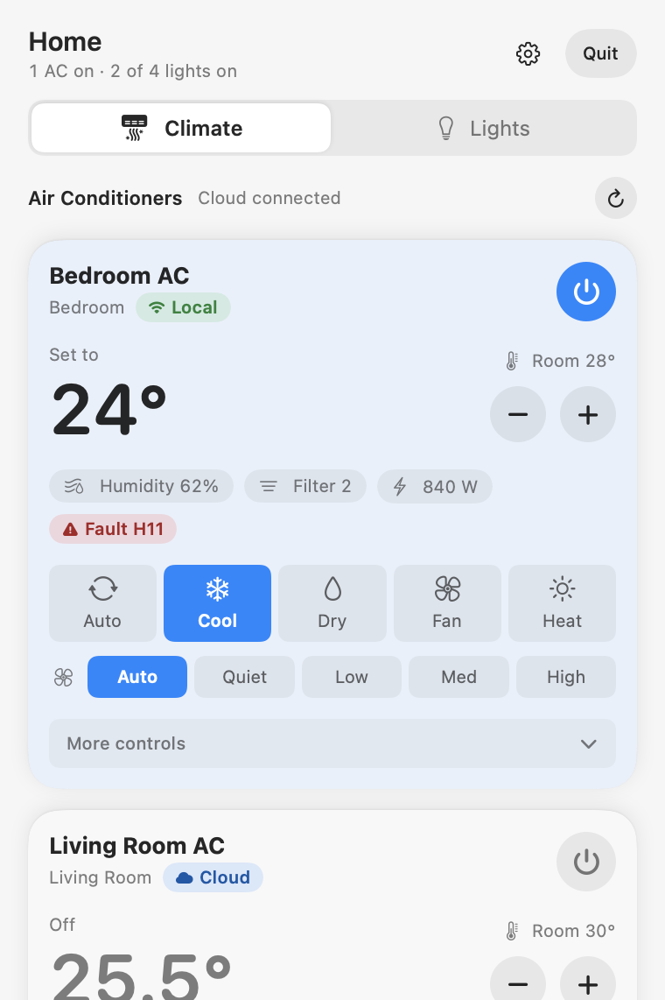
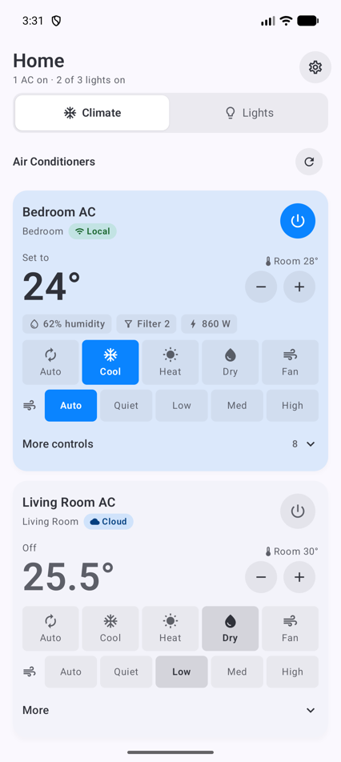
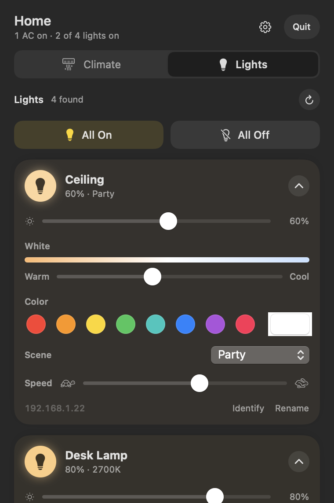
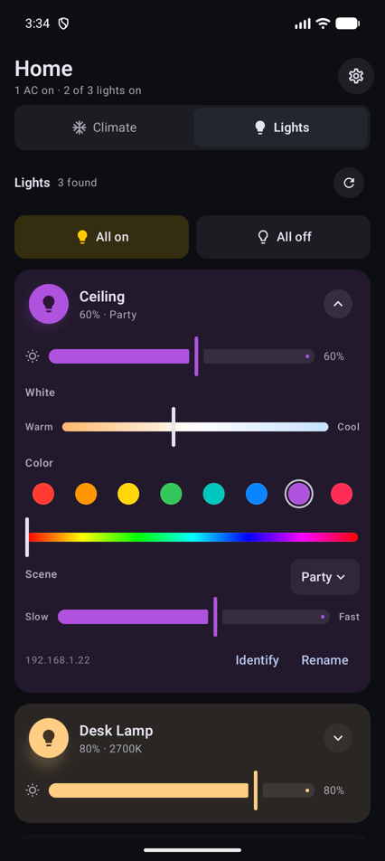

# Home Control

Control a **Panasonic MirAIe air conditioner** and **WiZ smart bulbs** from a macOS menu bar app and an Android app — over your own Wi-Fi, without depending on the vendors' clouds.

| macOS menu bar | Android |
|---|---|
|  |  |
|  |  |

*Screenshots use sample data.*

## Features

**Air conditioner (Panasonic MirAIe)**
- Power, target temperature (16–30 °C, 0.5° steps), mode (Auto/Cool/Dry/Fan/Heat), fan speed.
- Room temperature, plus humidity, filter level, PM2.5, power draw and fault codes when the AC reports them.
- "More controls", shown only if your model supports them: Powerful, ECO, Clean, nanoe G/X, Jet stream, Turbo, Beep, display On/Night/Off, vertical/horizontal swing, capacity (Convertible).
- **Local-first:** after one sign-in the app fetches the AC's LAN key and talks to it directly over UDP. The MirAIe cloud (MQTT) is used only as a fallback, or never with **Local network only**.
- **Key codes:** copy one `miraie-local-v1:…` code that holds every AC's LAN key. Paste it on another Mac or phone to control the AC with no Panasonic sign-in. Treat it like a password.
- **Diagnostics:** copy a shareable JSON of each AC's capabilities and last status. It never contains your password or tokens, and LAN keys are masked.

**Lights (WiZ)** — fully local, no WiZ/Signify account
- Auto-discovery, on/off, brightness, white temperature, colour swatches and custom colour, 32 scenes (grouped White/Colors/Moving) with speed, Identify (blink), local rename, All on/off.

**Apps**
- **macOS 14+** menu bar app (`HomeBar.app`), launch at login, Quit button.
- **Android 8+** app with a Quick Settings tile for AC power.

## Quick start

### macOS
Requires Swift 6 (Command Line Tools are enough; Xcode is not needed).
```bash
cd mac
./build-app.sh
cp -R HomeBar.app /Applications/ && open /Applications/HomeBar.app
```
Allow **Local Network** access when macOS asks.

### Android
Requires JDK 17 and the Android SDK.
```bash
cd android
JAVA_HOME=$(/usr/libexec/java_home -v 17) ./gradlew assembleDebug
adb install -r app/build/outputs/apk/debug/app-debug.apk
```

### First run
1. **Climate** tab → sign in with your MirAIe mobile number (or email) and password. Credentials stay on the device (macOS Keychain / Android EncryptedSharedPreferences).
2. The AC card should show a **Local** badge. **Cloud** means local control didn't answer; **Unreachable** in local-only mode means the AC wasn't found on this network.
3. Gear → **Copy AC key code** and store it in a password manager. You can then sign in anywhere with **Use a key code instead**.
4. WiZ bulbs: the phone or Mac must be on the same Wi-Fi. If no bulbs are found, check that local communication is allowed in the WiZ app's settings.

## Documentation

| File | For |
|---|---|
| [docs/ARCHITECTURE.md](docs/ARCHITECTURE.md) | How the apps are structured, data flow, storage, UI system |
| [PROTOCOL.md](PROTOCOL.md) | MirAIe cloud + LAN protocol and WiZ UDP protocol, with the full AC capability table |
| [docs/REVERSE_ENGINEERING.md](docs/REVERSE_ENGINEERING.md) | How the protocols were derived and how to re-verify against a new app version |
| [docs/ROADMAP.md](docs/ROADMAP.md) | What's next and which assumptions still need a real device |
| [AGENTS.md](AGENTS.md) | Build, test and contribution rules for coding agents (and humans) |

## Security notes
- The LAN key code and the copied diagnostics are the only things meant to leave the device. The key code controls your AC on your network — keep it private. Diagnostics are designed to be safe to share.
- Never commit vendor APKs or decompiled code; `.gitignore` excludes them.

## Disclaimer
Unofficial and not affiliated with Panasonic, MirAIe, WiZ or Signify. Protocols were observed for interoperability with devices you own. The cloud endpoints and LAN behaviour may change at any time. Use at your own risk.
